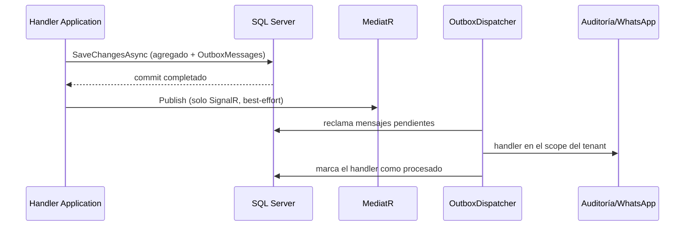

# Consistencia de datos y eventos de dominio

## Estado actual

`BaseEntity` acumula `DomainEvent`. Al guardar, `OutboxSaveChangesInterceptor` copia cada evento a `OutboxMessages` en la misma transacción; después del commit, `ApplicationDbContext` publica los eventos con MediatR solo para los handlers en proceso (SignalR), y el `OutboxDispatcher` ejecuta en segundo plano los handlers durables (`IOutboxEventHandler<T>`: auditoría y avisos de WhatsApp), con reintentos y registro por handler (ver [ADR 0006](../adr/0006-domain-events-and-outbox.md)).

Otras colas con la misma mecánica:

- **Inbox del webhook:** cada entrega de Meta se guarda en `InboxMessages` (deduplicada por hash) y se procesa en segundo plano; los mensajes ya guardados se reconocen por su id de proveedor.
- **Mensajes salientes:** campañas y recordatorios se encolan en `OutgoingMessages` con una clave de deduplicación única por negocio; el worker de mensajería los envía, reintenta y guarda su resultado. Iniciar una campaña encola todos sus mensajes en un solo `SaveChanges` (todo o nada).

## Implicaciones

El dato principal y sus efectos durables comparten transacción, pero los efectos ocurren después y pueden repetirse ante un reintento: por eso los handlers son idempotentes (la auditoría se guarda junto con el registro de que el handler terminó) y los envíos a proveedores aceptan el riesgo de un duplicado tras un timeout. SignalR sigue sin entrega garantizada.

## Reglas

- Las entidades producen eventos, pero no llaman WhatsApp, SignalR, correo, SMS, Blob ni HTTP.
- Handlers y servicios de Infrastructure ejecutan side effects.
- Todo handler susceptible a reintento es idempotente y usa claves/constraints de deduplicación.
- Un caso de uso coordina cambios sin esconder commits intermedios.
- Si varias escrituras deben ser atómicas (registro de negocio/cliente, confirmación de teléfono), el caso de uso usa `IApplicationDbContext.ExecuteInResilientTransactionAsync`: la transacción corre dentro de la estrategia de ejecución con reintentos, cada intento parte de un `ChangeTracker` limpio y solo hace commit si el `Result` es exitoso. No llames `Database.BeginTransactionAsync` directamente: la estrategia de reintentos de SQL Server rechaza transacciones iniciadas por el usuario. Correo/SMS se envían después del commit.
- Un comando que toma folio (crear venta, pedido del chat, pedido del menú en línea, movimiento de inventario, crear y recibir compra) implementa `ITransactionalRequest`: `TransactionBehavior`, el último del pipeline (después de autorización, validación y logging), corre todo el handler en una transacción con la misma estrategia; hace commit con un `Result` exitoso y deshace con uno fallido o una excepción, folio incluido. El primer intento conserva lo que el pipeline ya cargó; un reintento parte de un `ChangeTracker` limpio y vuelve a ejecutar el handler. Una solicitud enviada dentro de otra transacción se une a ella y no puede descartarla (`DiscardUnitOfWorkAsync` lanza una excepción en lugar de deshacer el trabajo de quien la envió). `ArchitectureTests` exige que estos comandos respondan `Result` y que todo handler que recibe `IFolioGenerator` corra en una transacción (Fase 4G).
- Los eventos de dominio de un `SaveChangesAsync` dentro de una transacción esperan al commit para publicarse (SignalR): una pantalla que recarga al recibirlos ya encuentra el dato. Si la transacción se deshace, no se publican. Fuera de una transacción se publican al terminar el guardado, como antes.
- Con MARS activo (`MultipleActiveResultSets=True`, así vienen las cadenas de conexión de la app), SQL Server no usa savepoints: un `SaveChanges` que falla dentro de una transacción deja aplicadas las sentencias que alcanzó a ejecutar. Un handler transaccional que atrapa `DbUpdateException` no debe seguir y responder éxito sobre esa transacción: responde un fallo (se deshace todo) o llama `DiscardUnitOfWorkAsync` y responde con datos que no escribió (venta duplicada sin conexión, ver abajo).
- Una consulta que incluye colecciones las lee en sentencias separadas (`UseQuerySplittingBehavior(SplitQuery)` en el registro del contexto, Fase 12): un join que trajera una orden con sus líneas, pagos, reembolsos e historial repetiría la orden por cada combinación. Application no elige el modo, porque no referencia el proveedor relacional. Fuera de una transacción, esas sentencias pueden ver un cambio hecho entre una y otra: lo que decide una escritura se protege con los tokens de concurrencia, no con lo leído.
- Los efectos críticos se implementan como `IOutboxEventHandler<T>` (entrega durable); los `INotificationHandler` quedan para efectos en proceso que pueden perderse.
- Si varias solicitudes modifican a la vez el mismo agregado (`Order`, `WhatsAppConversation`), este lleva `rowversion`. Ante `DbUpdateConcurrencyException`, el caso de uso recarga el agregado y reaplica su cambio con intentos acotados, en lugar de guardar valores absolutos calculados sobre una copia vieja.

## Pendiente

- Correlación de trazas entre la petición original y el procesamiento en segundo plano (hoy se registra el id del mensaje).
- El índice único de `InventoryMovement.ExternalReference` y las verificaciones de consumo/reverso ofrecen idempotencia parcial en inventario. Los folios (órdenes, movimientos y compras) salen de `FolioSequences` sin repetirse aunque dos solicitudes lleguen a la vez (Fase 4F). Los comandos que crean el documento corren en una transacción, así que una solicitud rechazada devuelve su folio (Fase 4G); el bloqueo de la fila del contador dura hasta el commit, de modo que las ventas de un mismo negocio se guardan de una en una desde que toman folio. Quedan huecos posibles en `INV` cuando un cambio de estado, cancelación, reembolso o el cierre de una cuenta abierta antes de la Fase 14 consume insumos y falla después de tomar folio: esos comandos no son transaccionales (cada ronda de una cuenta sí lo es desde la Fase 14) (algunos reintentan su guardado ante `DbUpdateConcurrencyException`, lo que con MARS no es seguro dentro de una transacción).
- Recibir una compra acepta una llave (`idempotencyKey`, Fase 11) que fija el `ExternalReference` de su movimiento: la misma recepción enviada dos veces, también a la vez, se registra una vez y la copia tardía deshace su transacción (`PurchaseReceptionSqlServerTests`).
- Un trabajo sin entidad que lo origine entra al outbox con `IOutbox` en la transacción de la petición (Fase 11, los códigos por SMS sin sesión; ver [ADR 0006](../adr/0006-domain-events-and-outbox.md)).
- Crear una venta acepta una clave del dispositivo (`Order.ClientRequestId`, índice único por tenant): la misma clave devuelve la venta ya creada, también si dos peticiones llegan a la vez (Fase 3, ventas sin conexión). La copia que llega tarde deshace toda su transacción (folio, pago, movimientos de caja y mensajes del outbox) antes de responder con la venta guardada; `SaleTransactionSqlServerTests` lo prueba en SQL Server con MARS (Fase 4G).
