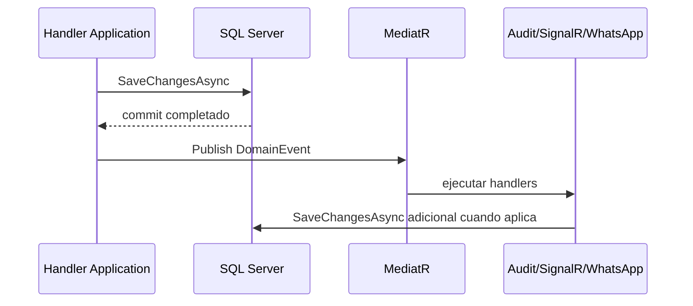

# Consistencia de datos y eventos de dominio

## Estado actual

`BaseEntity` acumula `DomainEvent`. `ApplicationDbContext.SaveChangesAsync` primero persiste con EF Core y luego publica los eventos mediante MediatR. Antes de publicar, los eventos se limpian; handlers de órdenes crean auditoría, actualizan inventario y ejecutan SignalR/WhatsApp. Algunos handlers vuelven a llamar `SaveChangesAsync`; una bandera evita recursión infinita.

El flujo comprobado es:

## Implicaciones

El commit original y los handlers no son atómicos. Si falla un handler después del primer commit, el dato principal queda persistido, el evento ya fue limpiado y algunos side effects pueden faltar. SignalR/WhatsApp tampoco comparten transacción con SQL. Por eso no se denomina “transaccional” a este proceso.

## Reglas

- Las entidades producen eventos, pero no llaman WhatsApp, SignalR, correo, SMS, Blob ni HTTP.
- Handlers y servicios de Infrastructure ejecutan side effects.
- Todo handler susceptible a reintento es idempotente y usa claves/constraints de deduplicación.
- Un caso de uso coordina cambios sin esconder commits intermedios.
- No se depende de eventos post-save para procesos críticos mientras no exista entrega durable.

## Arquitectura objetivo

Adoptar Outbox antes de hacer críticos los eventos o integraciones: persistir agregado y mensaje Outbox en la misma transacción, publicar asíncronamente, registrar intentos/estado, usar consumidores idempotentes y observabilidad/correlación. La Inbox puede añadirse para webhooks/comandos repetibles. No hay Outbox implementado actualmente.

El índice único de `InventoryMovement.ExternalReference` y las verificaciones de consumo/reverso ofrecen idempotencia parcial en inventario; los folios generados por conteo y algunos side effects externos aún tienen riesgos de concurrencia/reintento.
