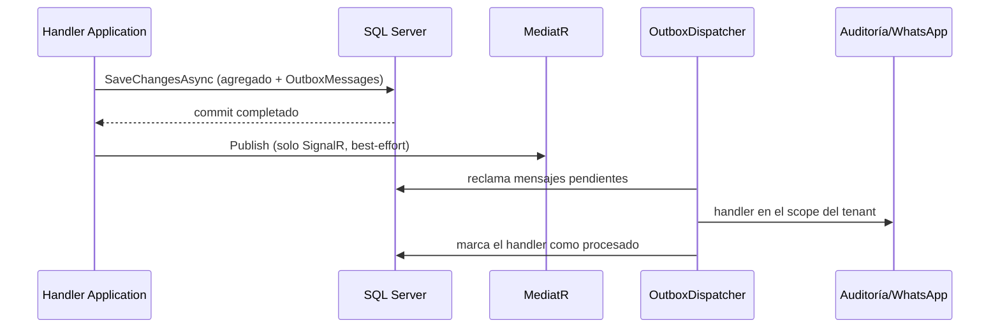

# Consistencia de datos y eventos de dominio

## Estado actual

`BaseEntity` acumula `DomainEvent`. Al guardar, `OutboxSaveChangesInterceptor` copia cada evento a `OutboxMessages` en la misma transacción; después del commit, `ApplicationDbContext` publica los eventos con MediatR solo para los handlers en proceso (SignalR), y el `OutboxDispatcher` ejecuta en segundo plano los handlers durables (`IOutboxEventHandler<T>`: auditoría y avisos de WhatsApp), con reintentos y registro por handler (ver [ADR 0006](../adr/0006-domain-events-and-outbox.md)).

Otras colas con la misma mecánica:

- **Inbox del webhook:** cada entrega de Meta se guarda en `InboxMessages` (deduplicada por hash) y se procesa en segundo plano; los mensajes ya guardados se reconocen por su id de proveedor.
- **Mensajes salientes:** campañas y recordatorios se encolan en `OutgoingMessages` con una clave de deduplicación única por negocio; el worker de mensajería los envía, reintenta y guarda su resultado. Iniciar una campaña encola todos sus mensajes en un solo `SaveChanges` (todo o nada).

## Implicaciones

El dato principal y sus efectos durables comparten transacción, pero los efectos ocurren después y pueden repetirse ante un reintento: por eso los handlers son idempotentes (la auditoría se guarda junto con el registro de que el handler terminó) y los envíos a proveedores aceptan el riesgo de un duplicado tras un timeout. SignalR sigue sin entrega garantizada.

## Reglas

- Las entidades producen eventos, pero no llaman WhatsApp, SignalR, correo, SMS, Blob ni HTTP.
- Handlers y servicios de Infrastructure ejecutan side effects.
- Todo handler susceptible a reintento es idempotente y usa claves/constraints de deduplicación.
- Un caso de uso coordina cambios sin esconder commits intermedios.
- Si varias escrituras deben ser atómicas (registro de negocio/cliente, confirmación de teléfono), el caso de uso usa `IApplicationDbContext.ExecuteInResilientTransactionAsync`: la transacción corre dentro de la estrategia de ejecución con reintentos, cada intento parte de un `ChangeTracker` limpio y solo hace commit si el `Result` es exitoso. No llames `Database.BeginTransactionAsync` directamente: la estrategia de reintentos de SQL Server rechaza transacciones iniciadas por el usuario. Correo/SMS se envían después del commit; los eventos de dominio de un `SaveChangesAsync` dentro de esa transacción se publican antes del commit.
- Los efectos críticos se implementan como `IOutboxEventHandler<T>` (entrega durable); los `INotificationHandler` quedan para efectos en proceso que pueden perderse.
- Si varias solicitudes modifican a la vez el mismo agregado (`Order`, `WhatsAppConversation`), este lleva `rowversion`. Ante `DbUpdateConcurrencyException`, el caso de uso recarga el agregado y reaplica su cambio con intentos acotados, en lugar de guardar valores absolutos calculados sobre una copia vieja.

## Pendiente

- Correlación de trazas entre la petición original y el procesamiento en segundo plano (hoy se registra el id del mensaje).
- El índice único de `InventoryMovement.ExternalReference` y las verificaciones de consumo/reverso ofrecen idempotencia parcial en inventario. Los folios (órdenes, movimientos y compras) salen de `FolioSequences` sin repetirse aunque dos solicitudes lleguen a la vez; se toman en una sentencia aparte del guardado del documento, así que una solicitud que falla después deja un hueco en la numeración (Fase 4F).
- Crear una venta acepta una clave del dispositivo (`Order.ClientRequestId`, índice único por tenant): la misma clave devuelve la venta ya creada, también si dos peticiones llegan a la vez (Fase 3, ventas sin conexión).
