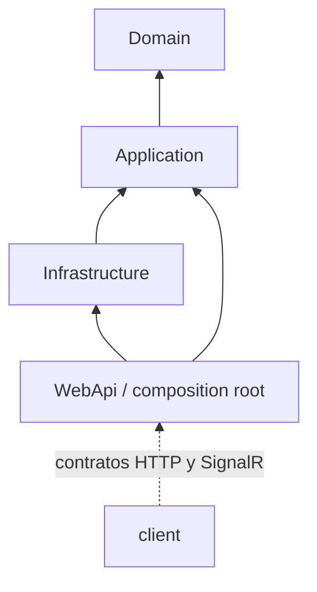

# Capas y dependencias

## Dirección obligatoria

- `Domain` no depende de Application, Infrastructure ni WebApi.
- `Application` depende de Domain.
- `Infrastructure` implementa interfaces definidas por Application.
- `WebApi` compone Application e Infrastructure.
- `client` consume contratos; no contiene reglas autoritativas.
- Ninguna capa salta Application para implementar un caso de uso.

## Responsabilidades

### Domain

Contiene invariantes y comportamiento de agregados, value objects, máquinas de estado y eventos. Las colecciones se exponen como solo lectura. Domain no conoce EF Core, HTTP, SignalR, almacenamiento ni proveedores. Excepción actual: el proyecto referencia `Microsoft.Extensions.Identity.Stores` y `MediatR.Contracts`; es una dependencia técnica existente que debe vigilarse para no ampliar acoplamiento.

### Application

Orquesta Commands/Queries, validación con FluentValidation, DTOs, interfaces de puertos, autorización contextual y transacciones del caso de uso. Usa `IApplicationDbContext`, lo que introduce referencias de EF Core en Application; es estado actual. Los DTOs se mapean a mano (`XxxMappings` junto a cada DTO); desde la Fase 4F no hay AutoMapper.

Los puertos que un caso de uso necesita son obligatorios en su constructor (`IOrderInventoryService`, `IOrderCashService`, `IFolioGenerator`): desde la Fase 4F no hay respaldos que no hagan nada si falta el registro, porque una venta guardada sin consumir inventario o sin entrar a la caja pasaría inadvertida. Las pruebas pasan sus dobles de forma explícita (`NoOpOrderInventoryService`, `NoOpOrderCashService` en `tests/.../Support`).

### Infrastructure

Implementa persistencia SQL Server, configuraciones y migraciones EF, Identity/JWT, archivos, imagen, WhatsApp, email, SMS, reloj y servicios coordinadores de inventario/caja. No debe introducir reglas que solo sean visibles desde un provider; si una regla es de dominio, muévela al agregado.

### WebApi

Es el composition root. Controllers deben recibir DTOs/commands, delegar a MediatR, mapear resultados HTTP y permanecer delgados. Middleware resuelve errores, tenant y controles transversales. La excepción actual más clara es `WhatsAppWebhookController`, que usa `IApplicationDbContext` directamente y contiene flujo considerable; se registra como deuda, no como patrón.

### client

Mantiene páginas, componentes, hooks, contextos, tipos y una única capa `src/api`. Puede calcular valores para presentación, pero backend decide estados, totales, impuestos, saldos y existencias finales.

## Guardrails de revisión

Rechaza un cambio si:

- añade referencia ascendente prohibida;
- retorna entidades de Domain/EF desde un endpoint;
- pone acceso a datos o integración en un controller;
- duplica reglas autoritativas en React;
- hace que una entidad invoque WhatsApp, SignalR, email, SMS, Blob o HTTP;
- modifica estado con setters/reflection fuera de materialización controlada;
- crea una abstracción sin consumidor o separa servicios sin necesidad comprobada.
