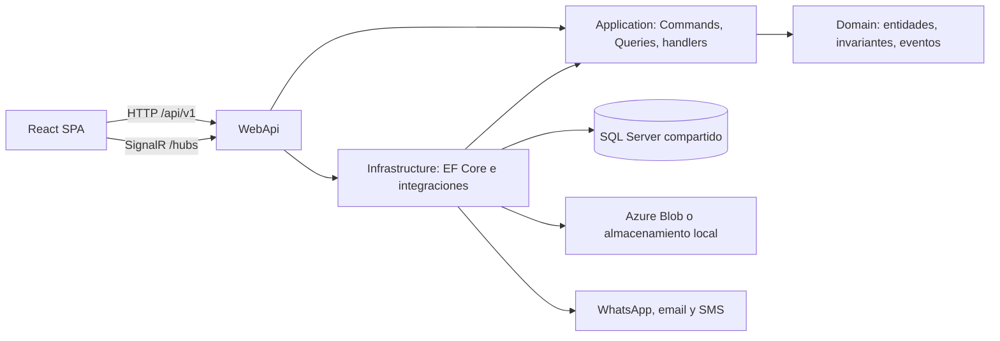

# Visión general del sistema

## Estado actual

TienditApp es un SaaS multi-tenant desplegado como una API ASP.NET Core que también publica el artefacto SPA. La solución contiene cuatro proyectos de backend y un cliente React. Los módulos comparten una base SQL Server mediante `ApplicationDbContext`.

El diagrama refleja referencias de proyecto y registros del composition root; no implica atomicidad entre SQL Server y proveedores externos.

### Proyectos

- `FoodParkDigital.Domain`: entidades, value objects, enums, eventos y máquinas de estado.
- `FoodParkDigital.Application`: casos de uso CQRS con MediatR, DTOs, validadores, mapeos e interfaces.
- `FoodParkDigital.Infrastructure`: EF Core, Identity/JWT, persistencia e implementaciones de integraciones.
- `FoodParkDigital.WebApi`: composition root, controllers, middleware, SignalR y publicación SPA.
- `client`: React 19/TypeScript/Vite.
- `tests`: xUnit para Domain, Application y WebApi, con algunos tests que ejercitan Infrastructure mediante EF InMemory.

## Decisiones arquitectónicas

El sistema se mantiene como monolito modular con Clean Architecture y DDD ligero. Los módulos se separan por contexto y caso de uso dentro del mismo despliegue y base compartida. CQRS significa separar Commands y Queries; no implica dos bases, event sourcing ni consistencia eventual por defecto.

No se propone migrar a microservicios. Solo se reconsiderará si un contexto necesita escalamiento independiente, aislamiento operativo, ownership de equipo separado o ciclos de despliegue distintos, y después de medir el costo transaccional y operativo.

## Operación actual

- Rutas HTTP bajo `/api/v1`; hubs en `/hubs/orders` y `/hubs/chat`.
- En Development, `Program.cs` ejecuta `MigrateAsync()` y seed al iniciar.
- En despliegue, el workflow `Deploy WebApp (API + SPA)` corre en cada push a `master`, o a mano desde `master`. Construye `client`, ejecuta lint, build y pruebas, publica WebApi con la SPA en `wwwroot` y despliega un paquete a Azure Web App.
- Serilog lee su configuración desde `appsettings`.
- El almacenamiento se elige por `FileStorage:Provider`: Azure Blob o local.

Consulta [capas y dependencias](layers-and-dependencies.md), [contextos](bounded-contexts.md) y [estado actual vs objetivo](../roadmap/current-vs-target.md).
