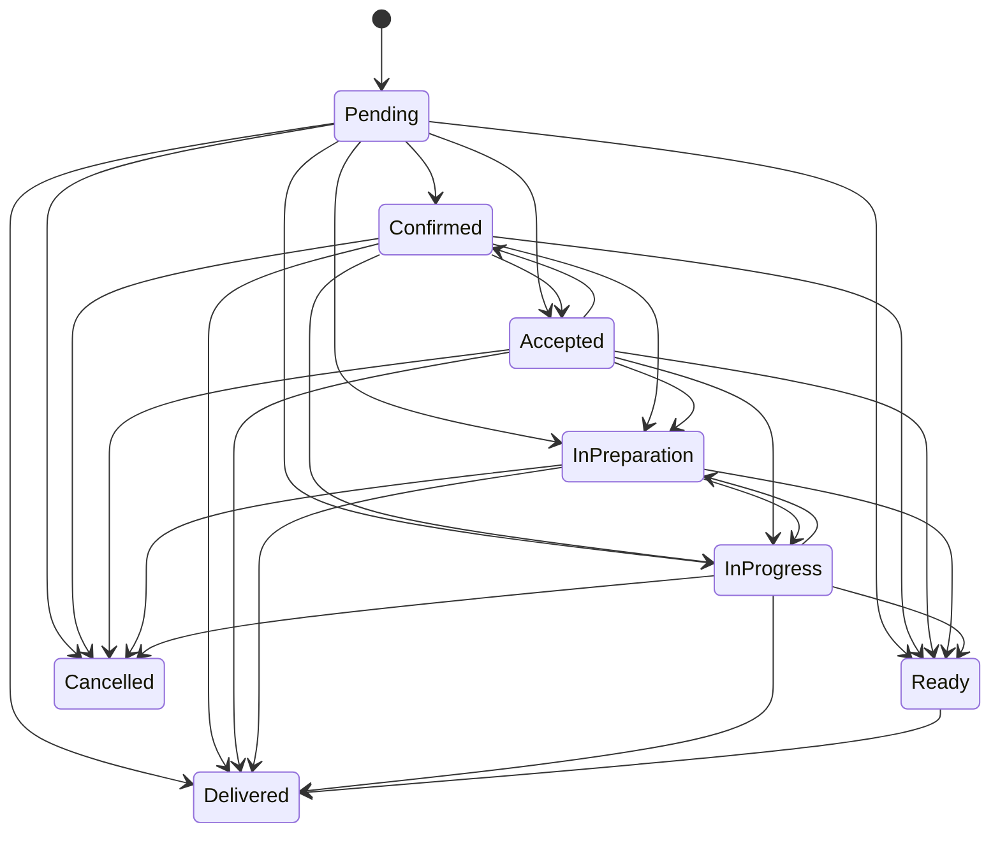
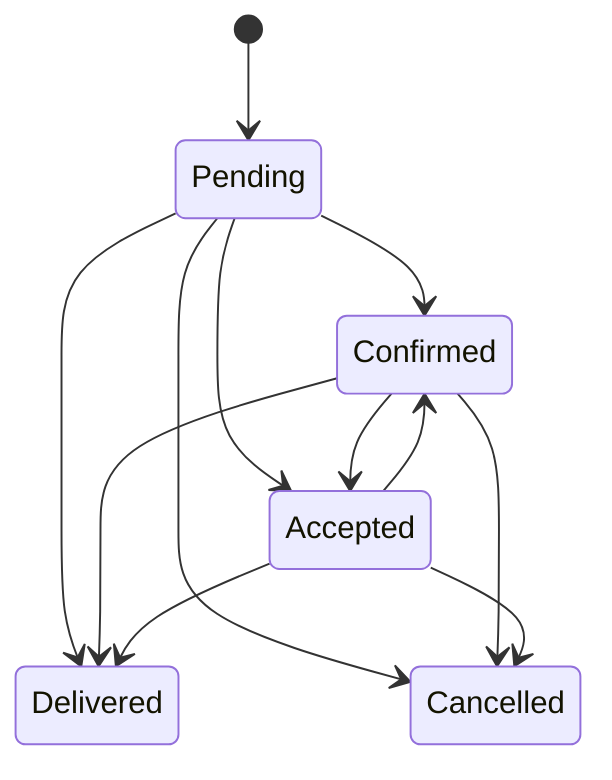
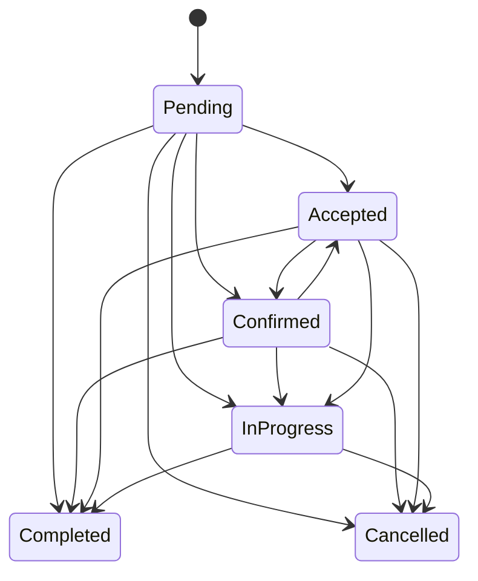
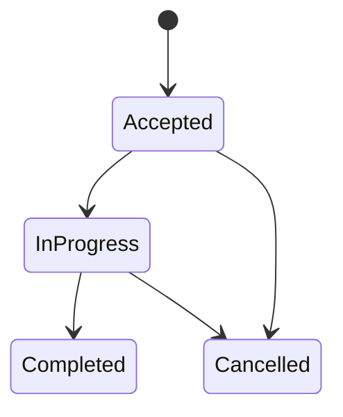
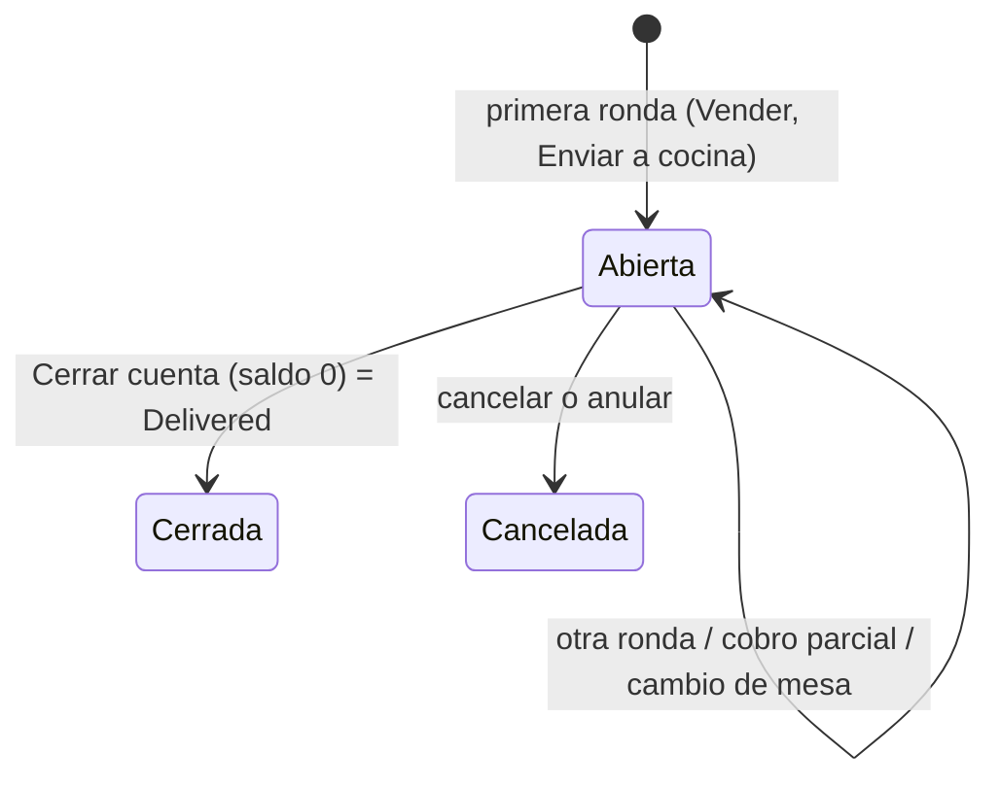

# Ciclos de vida de órdenes

Las transiciones siguientes provienen de las máquinas actuales. No son una propuesta.

## Food

## Retail

## Service

## Piezas de servicio

## Efectos coordinados actuales

- Al crear una orden de negocio, el caso de uso puede aplicar un estado inicial operativo (`Confirmed`) y consumo de inventario. El tablero de cocina lista solo pedidos de alimentos (`OrderType.Retail` de un negocio Food; las órdenes de servicio van a su tablero) en los estados anteriores a `Ready` (Pending, Confirmed, Accepted, InPreparation e InProgress). Se actualiza con los eventos de `OrderHub` del grupo del tenant, recarga al reconectar (los eventos perdidos no se reenvían) y sondea cada 30 segundos como respaldo. Desde la Fase 4 puede sonar con cada comanda nueva (activable por dispositivo). La cocina toma los pedidos de negocios de giro alimentos: un negocio de otro giro con el módulo de cocina no ve comandas hasta que el producto pueda marcarse como preparado en cocina.
- Al entrar en estados operativos definidos por `ShouldConsumeInventory`, se crea una salida idempotente por `ExternalReference`. En órdenes de servicio se consumen a nivel orden los productos que no se rastrean como pieza (por ejemplo, un producto vendido junto con el servicio); las líneas rastreadas consumen su receta al completar cada pieza.
- `CanCancel` se deriva de la tabla de transiciones de cada máquina, y `CancelOrderCommand` y `UpdateOrderStatusCommand` (con destino `Cancelled`) pasan por `Order.Cancel`: se rechaza si la orden conserva dinero sin reembolsar (neto pagado mayor a cero), se cancelan las piezas aceptadas o en progreso (las completadas se conservan) y se crea el movimiento compensatorio si existió consumo.
- Al completar una pieza, su receta se consume dentro del mismo comando y del mismo guardado que el cambio de estado; si falta stock y el negocio bloquea (por defecto), la pieza no cambia y el error nombra el insumo. Cada cambio de pieza pasa por `Order.ChangeServicePieceStatus`, que modifica la fila de la orden: dos piezas completadas al mismo tiempo chocan en el rowversion de `Order` y el comando reintenta con datos frescos, de modo que la orden sí llega a `Completed`.
- Las órdenes canceladas salen del tablero de servicios y no aceptan cambios de piezas ni pagos.
- Cierre automático de ventas de mostrador pagadas (política `AutoCloseCounterSales` del negocio, activa por defecto): al crear la venta, al registrar un pago y cuando la orden llega a `Ready`, `CounterSaleClosing` cierra una venta `CreatedByBusiness` sin saldo con la máquina de estados. Una venta pasa a `Delivered`; un pedido de comida de un negocio con Cocina espera a que la cocina lo marque `Ready`; un servicio pasa a `Completed` si no tiene piezas rastreadas pendientes. El cierre no envía WhatsApp.
- Reembolsar no cambia el estado: registra el reembolso, saca el efectivo de la caja y, si se pide, regresa insumos. "Anular venta" reembolsa lo que queda de cada pago y después cancela si la máquina lo permite; una orden ya entregada o completada queda en su estado, reembolsada por completo.
- Folios (Fase 4F): los tres caminos que crean órdenes (Vender, pedido del chat o de un número y menú en línea) comparten `OrderPlacement` y toman el folio de `IFolioGenerator` después de las validaciones sin efectos (total esperado, pagos que no exceden el total). Cada negocio tiene su contador en `FolioSequences` (ámbito `ORD`): en SQL Server un `UPDATE ... OUTPUT` toma el siguiente número bajo el bloqueo de la fila, así que dos cajas que venden al mismo tiempo nunca repiten folio (antes se contaban las órdenes y el choque respondía 500). El número se confirma de inmediato: una venta rechazada después (por ejemplo, por falta de existencias con la política de bloqueo) deja un hueco. Un contador que no existe se crea al primer uso, después del folio más alto que el negocio ya tenía.
- La auditoría y los avisos de WhatsApp de cada evento se procesan por el outbox, después del commit y con reintentos; SignalR se notifica en proceso (best-effort). Las notificaciones de citas se esperan dentro de la solicitud, son best-effort y muestran la hora del tenant; los recordatorios de citas salen por la cola de mensajería.

### Avisos al cliente (Fase 4)

Cada aviso de pedido (`order_confirmed`, `order_status_update`, `order_cancelled`) es una plantilla de WhatsApp que Meta cobra. La política del negocio (`TenantSettings.OrderNotificationPolicy`, en Mi negocio > Impuestos y ventas) decide qué pedidos los reciben; `OrderNotificationRules` la evalúa en el handler del outbox:

| Política | Quién recibe avisos |
| --- | --- |
| Pedidos a distancia y servicios (`RemoteAndServices`, por defecto) | Pedidos del cliente (menú en línea, su cuenta), pedidos que el negocio toma de un chat (canal WhatsApp) y servicios. Una venta de mostrador (`CreatedByBusiness`, canal `Counter`, que no es servicio) no: el cliente está ahí y tiene su ticket. |
| Todos los pedidos con teléfono (`AllOrders`) | También las ventas de mostrador con teléfono. |
| Ninguno (`Off`) | Nadie. |

- El cliente sabe del pedido una vez, al crearse: el estado inicial que aplica la venta (`Order.AdvanceOnCreation`, por ejemplo `Pending` → `Confirmed`) no manda además un "cambió a Confirmada". `OrderCreatedEvent.Status` lleva el estado con el que nació la orden.
- Un pedido que espera al negocio (`Pending`, pedido en línea sin aceptación automática) no recibe "pedido confirmado" al llegar; el cliente recibe el aviso cuando el negocio lo confirma.
- Los eventos guardados en el outbox antes de este cambio no traen `Status` y se leen como `Confirmed`, igual que los trataba el handler anterior.
- La baja del cliente (BAJA) no detiene estos avisos (ver [mensajería](messaging.md#bajas)).

## Cuentas abiertas por mesa (Fase 3)

Un negocio con el módulo Comida puede abrir una cuenta (`Order.IsTab`) para una mesa (`DiningTable`) o a nombre de alguien (barra, "Juan"). La cuenta es una sola orden: se cobra, factura y reembolsa como cualquier otra, pero recibe productos en rondas.

- Se abre desde Mesas (tocar una mesa libre) o "Cuenta sin mesa"; Vender cambia el cobro por "Enviar a cocina". Cada ronda (`OrderItem.Round`) crea una comanda (`KitchenTicket`) que la cocina avanza sola: Nueva, Preparando, Lista y Servida. El mesero marca "Servida" desde la cuenta.
- Una mesa tiene a lo más una cuenta abierta: `Orders.OpenTableId` vale la mesa mientras la cuenta está abierta y se limpia al cerrarla o cancelarla, con índice único filtrado (`IX_Orders_TenantId_OpenTableId_Open`) además de la validación del caso de uso.
- La cuenta queda en `Confirmed` mientras está abierta. No aparece en el tablero de pedidos (va por comandas), no admite cambios manuales de estado (solo cancelar) y el cierre automático de ventas pagadas no la cierra: se puede pagar por partes y seguir pidiendo. "Cerrar cuenta" exige saldo cero, pasa a `Delivered` con la máquina de estados y libera la mesa.
- El inventario de una cuenta se consume una sola vez, al cerrarla, con todas sus rondas (`OrderInventoryService` omite cuentas abiertas). Así ninguna ronda queda fuera del movimiento de consumo de la orden.
- Las rondas nuevas y los cambios de comanda emiten `TabRoundSentEvent` y `KitchenTicketChangedEvent`; Cocina y Mesas se actualizan con `KitchenTicketsChanged` de `OrderHub` y sondean como respaldo.
- Pendiente: cancelar un platillo de una ronda ya enviada (hoy se compensa con un reembolso), dividir la cuenta entre comensales y unir mesas.

## Pedidos en línea (Fase 3)

- En Mi negocio, "Menú en línea" tiene tres modos (`OnlineMenuMode`): apagado (por defecto), solo menú y menú con pedidos. El enlace es `/m/{slug}`; hay QR descargable, botón para compartir por WhatsApp y QR por mesa (`?mesa=Mesa 4`, que llega como mesa del pedido).
- El cliente arma el pedido con opciones y lo envía con su nombre y teléfono. Llega como cualquier pedido de cliente (`CreatedByBusiness = false`, canal `Online`, ligado a su cliente temporal o registrado), en `Pending` para que el negocio lo confirme, o en `Confirmed` si el negocio acepta pedidos automáticamente (`AutoAcceptOrders`). La cocina lo ve como cualquier pedido de comida.
- Mismas reglas de precio que en mostrador (`OrderLineBuilder`); el pedido se rechaza si el total cambió desde que el cliente lo vio, si un producto ya no está disponible o es un servicio.
- El cliente recibe el aviso por WhatsApp cuando el negocio confirma su pedido (o al llegar, si se acepta automáticamente), según la [política de avisos](#avisos-al-cliente-fase-4).
- Pendiente: pago en línea y entrega a domicilio con costo de envío.

## Variantes y extras (Fase 3)

- Un producto tiene hasta 10 grupos de opciones (`ProductOptionGroup`) con hasta 30 opciones (`ProductOption`). Mínimo 1 y máximo 1 es una variante obligatoria (tamaño); mínimo 0 hace el grupo opcional; máximo mayor a 1 permite varias (extras). Cada opción suma su precio (puede restar) y puede estar agotada.
- `Product.ResolveOptions` valida en el servidor lo elegido: que pertenezca al producto, que esté disponible, que no se repita y que cada grupo quede entre su mínimo y su máximo; `Product.PriceWith` da el precio unitario con opciones y nunca negativo. `OrderLineBuilder` aplica estas reglas igual en ventas, rondas y pedidos en línea.
- Cada línea guarda una copia de lo elegido (`OrderItemOption`: grupo, opción y precio). Editar el producto conserva el id de grupos y opciones que siguen existiendo; los quitados no alteran ventas pasadas.
- Ticket, cocina, cuenta y CFDI muestran las opciones ("Latte (Grande, Almendra)"). Las recetas de inventario son del producto; las opciones aún no consumen insumos propios.

## Ventas sin conexión (Fase 3)

- Cada venta de Vender lleva una clave generada en el dispositivo (`CreateOrderCommand.IdempotencyKey`, guardada como `Order.ClientRequestId` con índice único filtrado por tenant). Repetir la petición con la misma clave (un reintento tras un timeout o una venta enviada al volver la conexión) devuelve la venta ya creada en vez de cobrar dos veces; si dos peticiones con la misma clave llegan a la vez, el índice deja guardar una y la otra devuelve esa.
- Sin conexión, una venta de mostrador cobrada en ese momento se guarda en el dispositivo (IndexedDB `tienditapp-offline`, por negocio y cajero) con un folio provisional (`SC-0001`) y el ticket lo indica. No se guardan sin conexión las rondas de mesa, los pedidos del chat, las ventas sin cobrar ni las de servicios (su folio se usa para recoger las piezas).
- Al volver la conexión (evento del navegador, al abrir la app y cada 30 segundos mientras haya pendientes) se envían en orden, cada una con su clave y la hora de captura (`CapturedOfflineAt`). Solo las envía el cajero que las cobró, en el negocio donde las cobró: los pagos entran a su caja abierta en ese momento.
- El servidor vuelve a calcular cada venta con las reglas de siempre: rechaza la que tenga un total distinto (un precio cambió), un producto que ya no se vende o que se capturó hace más de 7 días (o más de 5 minutos en el futuro, por el reloj del dispositivo). La venta rechazada queda en el dispositivo como "No aceptada" con el motivo, para reintentarla o descartarla (con confirmación) y registrarla de nuevo. Sin red, con la sesión vencida (401), con demasiadas peticiones o con el servidor caído (502-504) el envío espera al siguiente intento; un error propio del servidor (500) se reintenta hasta 10 veces antes de marcarla como no aceptada.
- `Order.CapturedOfflineAt` guarda la hora del dispositivo como dato de auditoría; la venta y sus pagos llevan la hora del servidor (los cortes y los reportes cuentan por la hora de registro).
- Vender guarda el último catálogo cargado del negocio; si la API no responde, vende con él y lo avisa, y lo reemplaza al volver la conexión (o cada minuto mientras el servidor no responda).
- Límites: recargar la página o iniciar sesión sin conexión no funciona (no hay service worker y el token vive en memoria); la cocina no ve la venta hasta que se envía; cerrar sesión con ventas pendientes pide confirmación y se envían cuando ese usuario vuelve a entrar en ese dispositivo.

## Deuda e inconsistencias

- Las máquinas permiten saltos amplios (por ejemplo Pending a Delivered/Completed). Se documentan porque existen, no como flujo operativo ideal.
- Cancelar con `UpdateOrderStatusCommand` no registra motivo; el SPA usa el endpoint de cancelación, que sí lo pide.
- Desde la Fase 3 las cantidades admiten 3 decimales en kilo, litro, metro y hora (ver [finanzas](finance-payments-and-taxes.md#cantidades-decimales-y-datos-para-cfdi-fase-3)).
