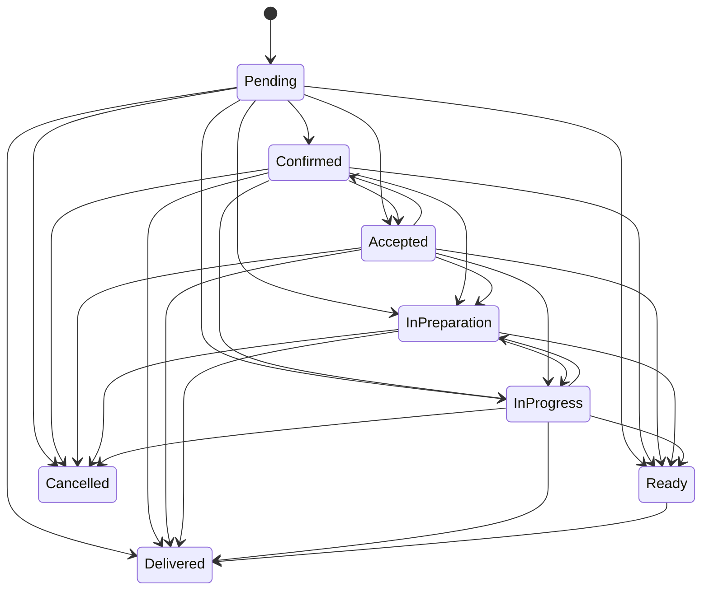
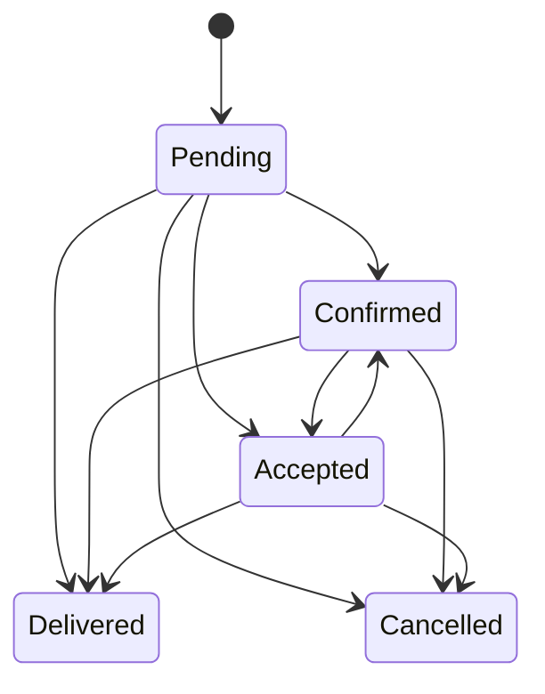
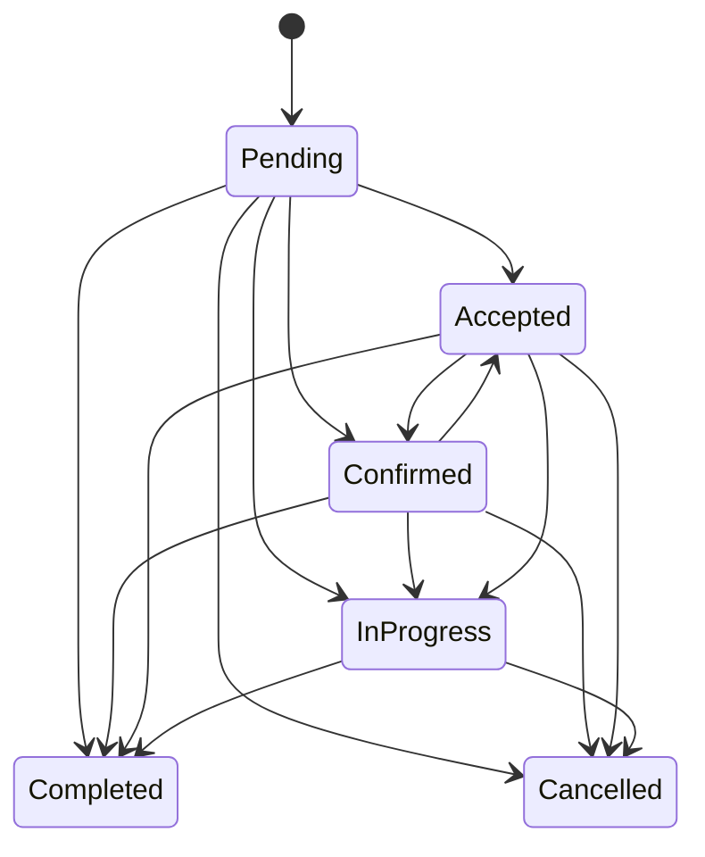
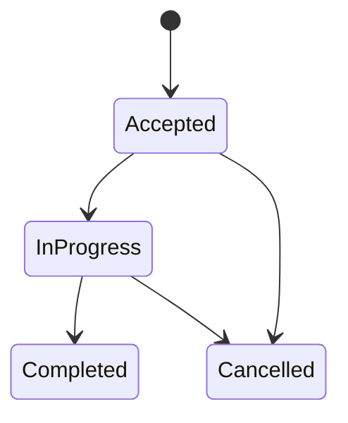

# Ciclos de vida de órdenes

Las transiciones siguientes provienen de las máquinas actuales. No son una propuesta.

## Food

## Retail

## Service

## Piezas de servicio

## Efectos coordinados actuales

- Al crear una orden de negocio, el caso de uso puede aplicar un estado inicial operativo y consumo de inventario.
- Al entrar en estados operativos definidos por `ShouldConsumeInventory`, se crea una salida idempotente por `ExternalReference`.
- Al cancelar, se crea un movimiento compensatorio si existió consumo.
- Al completar una pieza, se puede consumir su receta.
- Los eventos post-save crean auditoría y notifican por SignalR/WhatsApp.

## Deuda e inconsistencias

- `Cancel()` restringe Food a Pending/Confirmed/InPreparation, Retail a Pending/Confirmed/Accepted y Service a Pending/Accepted/Confirmed/InProgress; sin embargo, las tablas de transición permiten `Cancelled` desde más estados Food. `UpdateOrderStatusCommand` puede transicionar a `Cancelled` por la tabla, mientras `CancelOrderCommand` usa `CanCancel`. Debe unificarse en una decisión posterior.
- Las máquinas permiten saltos amplios (por ejemplo Pending a Delivered/Completed). Se documentan porque existen, no como flujo operativo ideal.
- `UpdateOrderStatusCommand` captura concurrencia por rowversion de `Order`; no todas las operaciones relacionadas tienen control equivalente.
- Cancelar mediante cambio de estado puede carecer de motivo.
