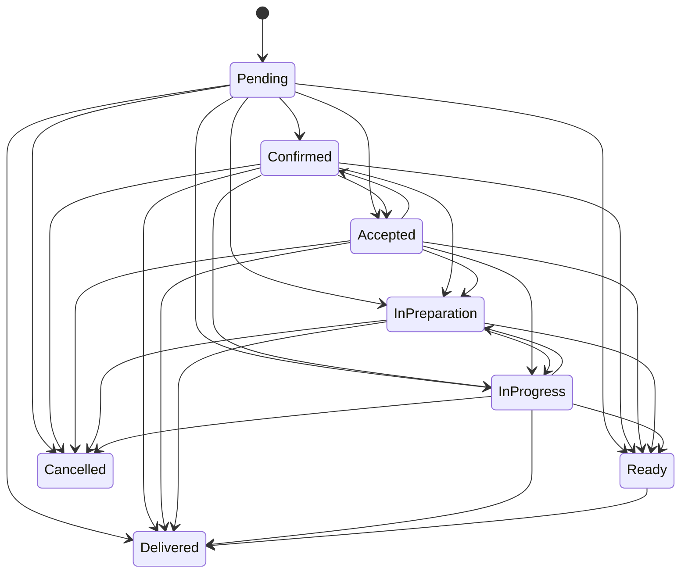
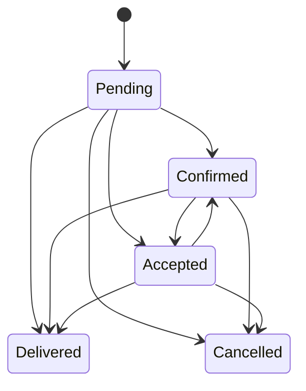
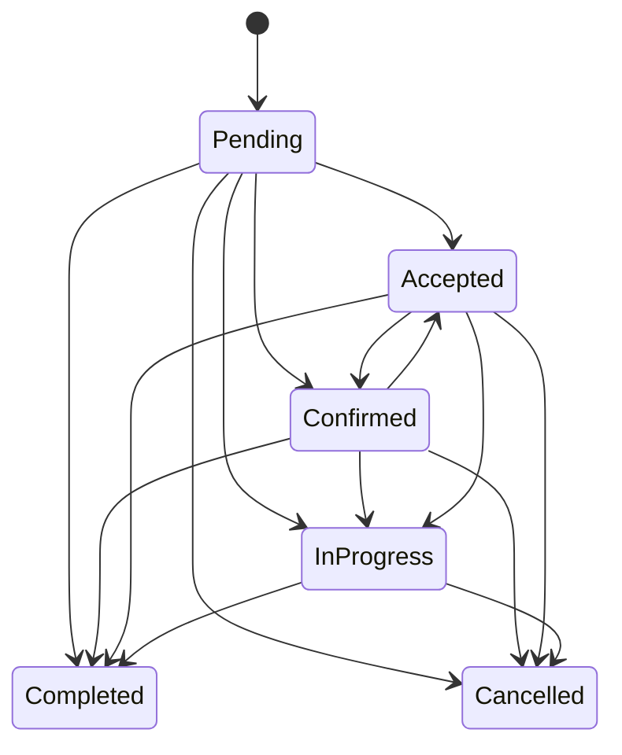
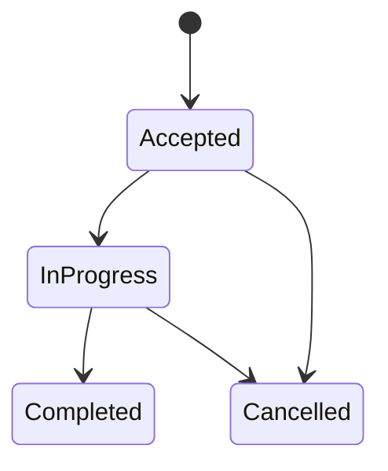

# Ciclos de vida de órdenes

Las transiciones siguientes provienen de las máquinas actuales. No son una propuesta.

## Food

## Retail

## Service

## Piezas de servicio

## Efectos coordinados actuales

- Al crear una orden de negocio, el caso de uso puede aplicar un estado inicial operativo (`Confirmed`) y consumo de inventario. El tablero de cocina lista solo pedidos de alimentos (`OrderType.Retail` de un negocio Food; las órdenes de servicio van a su tablero) en los estados anteriores a `Ready` (Pending, Confirmed, Accepted, InPreparation e InProgress). Se actualiza con los eventos de `OrderHub` del grupo del tenant, recarga al reconectar (los eventos perdidos no se reenvían) y sondea cada 30 segundos como respaldo.
- Al entrar en estados operativos definidos por `ShouldConsumeInventory`, se crea una salida idempotente por `ExternalReference`. En órdenes de servicio se consumen a nivel orden los productos que no se rastrean como pieza (por ejemplo, un producto vendido junto con el servicio); las líneas rastreadas consumen su receta al completar cada pieza.
- `CanCancel` se deriva de la tabla de transiciones de cada máquina, y `CancelOrderCommand` y `UpdateOrderStatusCommand` (con destino `Cancelled`) pasan por `Order.Cancel`: se rechaza si la orden tiene pagos, se cancelan las piezas aceptadas o en progreso (las completadas se conservan) y se crea el movimiento compensatorio si existió consumo.
- Al completar una pieza, su receta se consume dentro del mismo comando y del mismo guardado que el cambio de estado; si falta stock, la pieza no cambia. Cada cambio de pieza pasa por `Order.ChangeServicePieceStatus`, que modifica la fila de la orden: dos piezas completadas al mismo tiempo chocan en el rowversion de `Order` y el comando reintenta con datos frescos, de modo que la orden sí llega a `Completed`.
- Las órdenes canceladas salen del tablero de servicios y no aceptan cambios de piezas ni pagos.
- Los eventos post-save crean auditoría y notifican por SignalR/WhatsApp. Las notificaciones de citas se esperan dentro de la solicitud (antes eran fire-and-forget sobre el DbContext del request), son best-effort y muestran la hora del tenant.

## Deuda e inconsistencias

- Las máquinas permiten saltos amplios (por ejemplo Pending a Delivered/Completed). Se documentan porque existen, no como flujo operativo ideal.
- Cancelar con `UpdateOrderStatusCommand` no registra motivo; el SPA usa el endpoint de cancelación, que sí lo pide.
- No existen reembolsos: una orden pagada no puede cancelarse. Requiere el diseño de ajustes de ADR 0007.
- Las cantidades de `OrderItem` son enteras aunque existen unidades Kg, Litro, Metro y Hora; vender fracciones requiere una decisión de producto y una migración.
